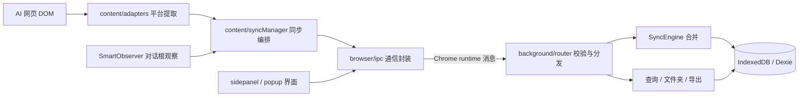
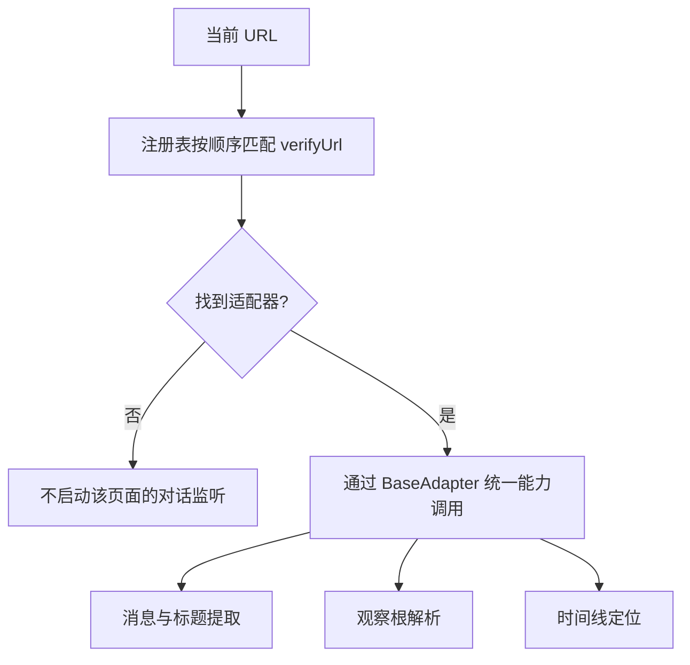
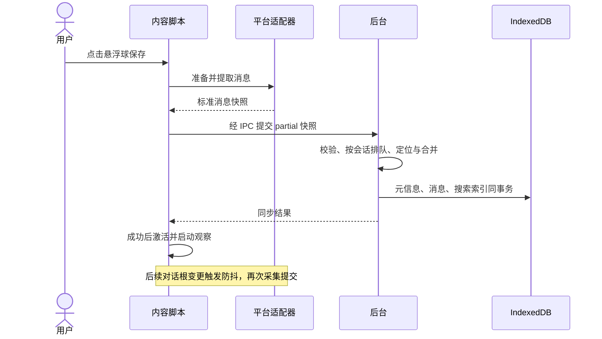

# MyChatMemo 架构与扩展指南

MyChatMemo 是 Chrome MV3 本地扩展。从 AI 网页提取对话后，通过扩展消息交给后台保存到 IndexedDB；侧边栏负责检索、整理和导出。首次手动保存成功后，该对话才会激活自动增量同步。

本文是实现机制和平台接入的现役说明。安装与命令见 [README.md](README.md)，开发约束见 [AGENTS.md](AGENTS.md)。

## 1. 运行全貌

扩展有三个独立入口：后台 Service Worker、注入 AI 网页的内容脚本、扩展自己的 SidePanel/Popup 页面。页内悬浮面板通过 iframe 复用侧边栏页面；悬浮球和时间线由内容脚本挂载。



箭头表示调用或数据流。页面与后台通过序列化消息通信，不共享数据库对象。后台回复结果，界面再更新状态；后台也可以向内容脚本发送徽章状态。

入口由 [public/manifest.json](public/manifest.json) 声明，[vite.config.ts](vite.config.ts) 使用 CRX 插件读取并构建该清单。

## 2. 分层如何解耦

| 位置 | 负责什么 | 依赖与边界 |
| --- | --- | --- |
| `src/content/` | 平台 DOM、观察、路由、同步触发、页内浮层 | 使用适配器、IPC、共享工具；不导入后台实现或 Dexie |
| `src/sidepanel/`、`src/popup/` | 搜索、文件夹、详情、选择和导出交互 | 通过 IPC 获取数据，不直接操作 IndexedDB |
| `src/browser/` | Chrome 消息封装 | 依赖共享协议和类型，不依赖具体后台 handler |
| `src/background/` | IPC 路由、同步合并、数据库、搜索和导出 | 独占 IndexedDB；不依赖页面组件、window 或 document |
| `src/shared/` | 平台无关工具、常量、协议与纯校验 | 不调用 DOM、Chrome、网络或存储 API |
| `src/types/` | 对话、消息、文件夹等领域类型 | 仅类型定义、类型导入与导出 |
| `src/infrastructure/` | 日志、错误分类和错误提示 | 后台与页面可共用，不依赖 React 或页面 DOM |
| `src/ui/` | 公共图标、通知和布局 Hook | 依赖 React/DOM，仅供页面与内容脚本使用 |

分层按运行环境和职责划分。后台 router、SyncEngine 与 database 仍有直接协作，尚未引入统一 Repository 接口或依赖注入容器；当前规模通过明确边界和测试维护。

三个关键解耦点：

1. **网站差异止于适配器**：上层拿到统一 `RawMessage[]`，不需要理解各网站的 DOM。
2. **持久化止于后台**：内容脚本提交快照，界面请求列表，都不需要理解 Dexie 索引和事务。
3. **公共代码按能力归属**：DOM→Markdown 在 content，Chrome 通信在 browser，公共组件在 ui；shared 保持无平台副作用。

[eslint.config.mjs](eslint.config.mjs) 对主要跨层导入和受限全局变量执行检查，同时检查 Hooks 使用及依赖项。规则不能代替代码评审或浏览器隔离机制。

## 3. “插拔式”平台接入如何实现

### 3.1 契约：把各网站包装成同一种能力

[BaseAdapter](src/content/adapters/base.ts) 定义适配器契约和默认实现：

| 成员 | 用途 | 实现方式 |
| --- | --- | --- |
| `platform`、`platformLabel` | 平台标识和显示名称 | 子类声明 |
| `verifyUrl(url)` | 判断能否处理当前地址 | 子类实现 |
| `extractConversationId(url)` | 提取稳定会话 ID | 子类实现 |
| `extractMessages()` | 输出带角色、正文、位置的 `RawMessage[]` | 子类实现 |
| `getSelectors()` | 返回平台选择器配置 | 子类实现 |
| `extractTitle()` | 提取标题 | 可继承或覆盖 |
| `getObservationRoot()` | 返回整个对话的稳定观察根 | 可继承或覆盖；不得返回 body/html |
| `getUserTurns()` | 返回时间线需要的用户消息元素与摘要 | 可继承或覆盖；UI 不判断平台 DOM |
| `prepareForExtraction()` | 采集前异步准备，如滚动虚拟列表 | 默认无操作，可覆盖 |
| `sanitizeContent()` | 清洗正文并转换 Markdown | protected，可覆盖或调用 super |

`SelectorConfig` 区分 observationRoot、messageContainer、userContent、assistantContent 等字段。观察根覆盖整段对话，单条消息选择器用于提取，两者不能混用。

基类回退查询按顺序选中首个有效结果；批量查询取首个非空结果集，不合并所有回退选择器的结果。部分平台覆盖提取方法，仍需检查其具体实现。

DOM→Markdown 公共实现位于 [elementToMarkdown.ts](src/content/elementToMarkdown.ts)，先克隆节点、移除按钮等干扰元素，再处理代码、列表和表格，避免修改原网页。

### 3.2 注册：一个入口选择具体实现

[registry.ts](src/content/adapters/registry.ts) 在模块加载时创建内置实例：

```ts
adapterRegistry.register(new KimiAdapter());
adapterRegistry.register(new DoubaoAdapter());
adapterRegistry.register(new GeminiAdapter());
adapterRegistry.register(new ChatGPTAdapter());
```

页面入口使用：

```ts
const adapter = adapterRegistry.getAdapter(window.location.href);
```

注册表依次调用 verifyUrl，返回第一个匹配实例，没有匹配时返回 null。注册顺序影响重叠 URL 的选择，新增适配器必须避免匹配范围过宽。



同步管理器、观察器和时间线消费统一能力。因此修某个平台的 DOM，通常只修改该适配器及测试；通用保存和数据库逻辑无需增加平台分支。

### 3.3 配置分布与新增平台步骤

当前扩展方式是**随扩展打包的适配器注册**。平台能力、清单权限和类型校验需要在源码中同步配置，然后重新构建、重新加载扩展。当前没有用户可编辑的插件 JSON、远程加载、热安装或运行时启停平台的界面。

| 配置位置 | 控制什么 |
| --- | --- |
| `src/content/adapters/<平台>.ts` | URL、DOM 选择器和提取策略 |
| `src/content/adapters/registry.ts` | 启用的内置适配器及匹配顺序 |
| `public/manifest.json` 的 `content_scripts.matches` | Chrome 向哪些网页注入内容脚本 |
| 清单的 `host_permissions` | 扩展声明的网站访问范围 |
| 清单的 `web_accessible_resources.matches` | 哪些网页可访问嵌入的侧边栏资源 |
| `src/types/conversation.ts` 的 `Platform` | 数据模型的平台标识 |
| `src/shared/constants.ts` 的 `PLATFORM_LABELS` | 共用显示名称 |
| `src/shared/protocolValidation.ts` 的平台白名单 | 后台运行时允许接收的平台快照 |

新增平台时：

1. 新建适配器子类，实现必需方法，实现或继承观察根、标题和时间线能力。参考 [ChatGPTAdapter](src/content/adapters/chatgpt.ts) 等现有实现。
2. 在 registry 注册实例；需要从模块公共入口引用时，补 adapters/index.ts 导出。
3. 对齐上表中的 Platform、显示名、后台白名单和清单域名。
4. 添加 URL、ID、消息提取、观察根和时间线测试，验证编辑态、虚拟列表等平台特有行为。
5. 运行 `npm run check`，重新加载扩展，在真实平台验证首次保存、后续多轮和站内导航。

只注册类而不配置注入地址，内容脚本不会进入新网站；只配置地址而不注册，入口找不到适配器；遗漏后台白名单，采集后提交会被拒绝。这些配置目前需要人工对齐，是接入时明确的维护点。

停用平台时移除注册并核对清单域名；已有历史数据仍要能够检索和导出，不应随意删除持久化类型、显示名或更改数据库主键。claude 当前仅为类型预留，没有对应注册和注入配置。

## 4. 配置与用户数据分开存放

项目不要求环境变量。平台选择器、注册关系和观察延迟属于源码配置，不存放在 Chrome Storage。

- [shared/constants.ts](src/shared/constants.ts) 提供默认防抖、分页和界面常量；SmartObserver 支持构造参数覆盖延迟。
- `chrome.storage.local` 保存已激活对话的键集合，键由平台与会话 ID 组成。启动时向后台核对记录是否还存在，过滤失效激活项。
- IndexedDB 保存对话元信息、消息正文、文件夹和搜索索引，统一由后台访问。

“只在后台访问数据库”指 IndexedDB 持久化边界；内容脚本仍会读写自己的激活状态，并访问页面 DOM。

## 5. 从手动保存到自动同步



[syncManager.ts](src/content/syncManager.ts) 管理激活状态和在途采集；同一会话与路由版本的请求可以合并。快照发送后又有新变更，会标记 dirty，待当前请求完成后补采，避免漏掉最后一次更新。

[SmartObserver](src/content/smartObserver.ts) 默认 1500ms 防抖，只监听对话根的 childList/subtree；连续变化在 10 秒时触发快照。没有 DOM 事件时不会定时备份，也不监听 characterData。

根延迟出现或替换时重新解析绑定；连续缺根约 10 秒后暂停密集检查，focus/visibility 事件或成功手动保存可以恢复。stop 会清理观察器、计时器和监听器。

内容脚本处于隔离世界，[routerInterceptor.ts](src/content/routerInterceptor.ts) 通过 500ms URL 检查及 popstate/hashchange/visibility 事件识别站内导航。路由变化停止旧观察；异步采集、响应与激活检查路由版本，防止旧任务作用到新页面。

## 6. IPC 与数据安全

[shared/protocol.ts](src/shared/protocol.ts) 的 IPCRequestMap 按动作关联请求参数与成功数据。browser/ipc.ts 从动作推导类型，后台 handler 表和校验表必须覆盖所有请求动作。编译器检查接线，运行时仍由 [protocolValidation.ts](src/shared/protocolValidation.ts) 校验 unknown 消息、字段及允许的动作，然后 router 才调用处理器。

[SyncEngine](src/background/syncEngine.ts) 负责保守增量合并：

- snapshot 缺省为 partial；当前内容脚本显式发送 partial，缺席消息不会触发历史删除。
- 首次保存建立记录；已有历史通过角色与正文的唯一重叠锚点定位。Rabin–Karp 滚动匹配筛选窗口，再做精确验证。
- 无唯一锚点或中段位置冲突时拒绝合并并保留历史。尾部允许可确认的流式增长，旧快照不能截短已存正文。
- complete 是协议支持的显式完整快照能力。手动保存或允许滚动采集的 fullPage 都不能自动证明完整。
- 同一后台运行实例内，按数据库名和会话 ID 共享队列，串行处理不同标签页请求；不同 SyncEngine 实例也共享该队列。
- 元信息、消息和搜索索引在一个 Dexie 事务中写入，失败一起回滚。

[database.ts](src/background/database.ts) 当前 schema 为 v7，现役表为 conversations、messages、folders、searchIndex。消息使用独立 conversationId 索引与 `[conversationId+metadata.position]` 复合索引。已有版本迁移用于旧数据升级，应保留迁移历史。

## 7. 界面内部如何拆分

- useConversationData 编排列表、文件夹与筛选；useConversationSearch 集中管理搜索阶段、防抖、分页和请求范围。换词或切文件夹立即使旧结果失效，旧刷新闭包不能重启旧查询。
- App 独立管理详情加载，列表、详情和搜索不再共同写同一个 loading 开关。
- FolderTree 负责筛选计数与面板编排，useFolderEditor 管理互斥编辑会话，FolderTreeItem 与 FolderNameInput 展示节点和输入。会话标识防止旧 blur 重复提交。
- ConversationList 使用 react-window 和 overscanCount=3；界面操作经 IPC 请求后台。
- 错误模块负责分类与提示，日志统一经 infrastructure/logger 输出；可读错误消息使用安全字符串转换。

## 8. 维护验证与已知边界

`npm run check` 执行格式、源码与测试类型、ESLint、完整测试和生产构建，CI 使用同一入口。`npm run test:coverage` 单独检查全项目 70% 门槛；当前行/语句覆盖仍未达标，需补存量 UI 与入口交互测试。测试数量与覆盖率以当次命令输出为准。

- 当前后台全文搜索扫描搜索索引，分页返回不等于查询已经高效。
- 复杂 Markdown、无重叠消息、分支或中段编辑可能安全拒绝同步；以后扩展应先补稳定消息标识和完整性证据。
- 纯文本节点变化不单独触发观察器；一个检查周期内完整发生且未被其它检查捕获的 A→B→A 导航可能漏检。
- JSDOM 测试和构建不能证明四个平台当前线上 DOM 可用。发布前仍需真实 Chrome 验证首次保存、多轮对话、流式代码、长对话和路由切换。
